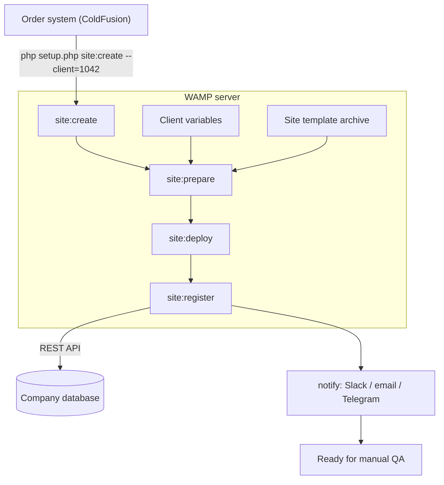

# php-cli-site-deploy

## Task

One PHP CLI command deploys a new customer site on a WAMP server (Windows, Apache, MySQL, PHP). No WordPress, no browser.

- Triggered by the order system (ColdFusion) with the client parameter.
- Client variables + site template (archive) go into the script.
- The script deploys the site: files, database, Apache.
- Site data is written to the company database via the existing REST API.
- Notification: site ready for manual QA.

Demo client: `Rotary Club of Springfield` → `rcspringfield.test`

```bash
php setup.php site:create --client=1042
```

## Snippet: setup.php

<!-- wp:code {"className":"language-php"} -->
<pre class="wp-block-code language-php"><code lang="php" class="language-php">&lt;?php
/**
 * setup.php — automated site setup on WAMP (core PHP, no WordPress).
 * Usage: php setup.php site:create --client=1042
 */

if (PHP_SAPI !== 'cli') {
    exit("CLI only\n");
}

$command = $argv[1] ?? '';
$options = getopt('', ['client:']);
$clientId = (int) ($options['client'] ?? 0);

if ($command !== 'site:create' || $clientId &lt;= 0) {
    fwrite(STDERR, "Usage: php setup.php site:create --client=&lt;id&gt;\n");
    exit(1);
}

$config = require __DIR__ . '/config.php';

try {
    $site = site_prepare($clientId, $config);   // client variables + template
    site_deploy($site, $config);                // files, MySQL, Apache vhost
    site_register($site, $config);              // REST API
    notify("{$site['domain']} ready for manual QA", $config);
    echo "Success: {$site['domain']} deployed.\n";
    exit(0);
} catch (Throwable $e) {
    fwrite(STDERR, "Error: {$e-&gt;getMessage()}\n");
    exit(1);
}

function site_prepare(int $clientId, array $config): array
{
    $client = api_request('GET', "/clients/{$clientId}", null, $config);
    $slug   = preg_replace('/[^a-z0-9]/', '', strtolower($client['slug']));
    $path   = $config['www_root'] . DIRECTORY_SEPARATOR . $slug;

    if (is_dir($path)) {
        throw new RuntimeException("Site folder already exists: {$path}");
    }

    $zip = new ZipArchive();
    if ($zip-&gt;open($config['template_zip']) !== true) {
        throw new RuntimeException('Cannot open template archive');
    }
    $zip-&gt;extractTo($path);
    $zip-&gt;close();

    $vars = [
        '{{SITE_TITLE}}'  =&gt; $client['name'],
        '{{SITE_DOMAIN}}' =&gt; "{$slug}.{$config['tld']}",
        '{{DB_NAME}}'     =&gt; $slug,
        '{{DB_USER}}'     =&gt; $slug,
        '{{DB_PASS}}'     =&gt; bin2hex(random_bytes(12)),
    ];
    $tpl = file_get_contents("{$path}/config.tpl.php");
    file_put_contents("{$path}/config.php", strtr($tpl, $vars));
    unlink("{$path}/config.tpl.php");

    return ['client_id' =&gt; $clientId, 'slug' =&gt; $slug, 'path' =&gt; $path,
            'domain' =&gt; $vars['{{SITE_DOMAIN}}'], 'vars' =&gt; $vars];
}

function site_deploy(array $site, array $config): void
{
    $pdo  = new PDO($config['mysql_dsn'], $config['mysql_user'], $config['mysql_pass'],
                    [PDO::ATTR_ERRMODE =&gt; PDO::ERRMODE_EXCEPTION]);
    $db   = $site['vars']['{{DB_NAME}}'];
    $user = $site['vars']['{{DB_USER}}'];

    $pdo-&gt;exec("CREATE DATABASE `{$db}` CHARACTER SET utf8mb4 COLLATE utf8mb4_unicode_ci");
    $pdo-&gt;prepare("CREATE USER ?@'localhost' IDENTIFIED BY ?")
        -&gt;execute([$user, $site['vars']['{{DB_PASS}}']]);
    $pdo-&gt;exec("GRANT ALL ON `{$db}`.* TO '{$user}'@'localhost'");

    $pdo-&gt;exec("USE `{$db}`");
    $pdo-&gt;exec(file_get_contents("{$site['path']}/install/template.sql"));

    $vhost = strtr(file_get_contents($config['vhost_tpl']), [
        '{{DOMAIN}}' =&gt; $site['domain'],
        '{{ROOT}}'   =&gt; $site['path'],
    ]);
    file_put_contents("{$config['vhosts_dir']}/{$site['slug']}.conf", $vhost);

    exec($config['apache_restart'], $out, $code);
    if ($code !== 0) {
        throw new RuntimeException('Apache restart failed');
    }
}

function site_register(array $site, array $config): void
{
    api_request('POST', '/sites', [
        'client_id' =&gt; $site['client_id'],
        'domain'    =&gt; $site['domain'],
        'path'      =&gt; $site['path'],
        'status'    =&gt; 'qa',
    ], $config);
}

function api_request(string $method, string $endpoint, ?array $body, array $config): array
{
    $ch = curl_init($config['api_url'] . $endpoint);
    curl_setopt_array($ch, [
        CURLOPT_CUSTOMREQUEST  =&gt; $method,
        CURLOPT_RETURNTRANSFER =&gt; true,
        CURLOPT_HTTPHEADER     =&gt; ['Content-Type: application/json',
                                   'Authorization: Bearer ' . $config['api_token']],
        CURLOPT_POSTFIELDS     =&gt; $body ? json_encode($body) : null,
    ]);
    $response = curl_exec($ch);
    $status   = curl_getinfo($ch, CURLINFO_HTTP_CODE);
    curl_close($ch);

    if ($status &lt; 200 || $status &gt;= 300) {
        throw new RuntimeException("API {$method} {$endpoint} failed: HTTP {$status}");
    }
    return json_decode($response, true) ?? [];
}

function notify(string $message, array $config): void
{
    // Slack / email / Telegram — one channel shown.
    api_request('POST', '/notifications', ['message' =&gt; $message], $config);
}</code></pre>
<!-- /wp:code -->

## Flow



## Emulation steps

| # | Step | Action | Output |
|---|------|--------|--------|
| 1 | init | Validate `--client=1042` | `Client 1042: Rotary Club of Springfield` |
| 2 | site:prepare | Load client variables | `domain, title, admin email, colors` |
| 3 | site:prepare | Download template archive | `template-v3.zip [##########] 100%` |
| 4 | site:prepare | Unpack to `C:\wamp64\www\rcspringfield` | `412 files extracted` |
| 5 | site:prepare | Substitute variables in config | `config.php generated` |
| 6 | site:deploy | Create database and user | `DB rcspringfield created` |
| 7 | site:deploy | Import SQL | `template.sql [##########] 100%, 38 tables` |
| 8 | site:deploy | Apache vhost + restart | `rcspringfield.test → 200 OK` |
| 9 | site:register | Write site data via REST API | `POST /api/sites → 201 Created` |
| 10 | notify | Send notification | `Ready for manual QA` |
